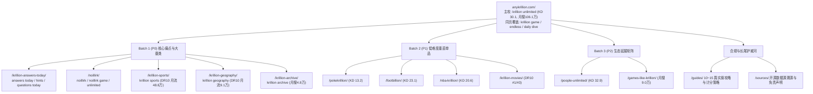

# Krillion Game 生态调研与建站实战方案

> **调研日期**：2026-11-14  
> **数据来源**：工作区哥飞新词监测记录（`gefei_new_term_full.txt`）、全网实时检索、以及对五大标杆竞品站点（`krillion.io`、`krillion.org`、`goalillion.com`、`footbillion.net`、`playdaily.org`、`playlin.io`）的 Sitemap、DOM 结构与前端代码实测抓取。

---

## 一、游戏本体与核心机制（Krillion 是什么）

* **基本档案**：由独立开发者 Jing Lee（网名 *kp*）于 **2026 年 8 月**推出的浏览器端每日休闲问答游戏，官网为 [`krillion.io`](https://krillion.io/)，同期在 Google Play 上架移动端应用 *Krillion: Daily Trivia Dive*。
* **核心机制（The Daily Dive / 深海下潜）**：
  * **题量与限时**：全球玩家每天收到相同的 **7 道开放式提示题**（覆盖地理、流行文化、生物、语言、游戏等类别），每题限时 **25 秒**纯手打输入，**无任何选择题选项**。
  * **反向稀有度计分（越冷门分越高）**：不同于传统答题游戏只看对错，Krillion 的目标是在“答案合法准确”的前提下，尽量写出**最少人想到的冷门答案（Deep Cut）**。
  * **下潜深度换算**：每 1 分对应下潜 **10 米**；单题最高 **100 分**（下潜 1,000 米），7 题满分可完成 **7,000 米深海海沟**的完美下潜（Perfect Dive）。
* **稀有度等级体系（Rarity Tiers）**：
  * **Plankton（浮游生物，低分档，如 10 pts）**：大众第一反应就会填的显而易见答案（例如瀑布填 *Niagara Falls*）。
  * **Too Clever（聪明反被聪明误陷阱）**：自以为很冷门、但实际上大量想“装懂”的玩家都填了同一个第二热门选项（例如为了避开尼亚加拉瀑布而全都填 *Angel Falls*），导致稀有度拉低。
  * **Schooler / Uncommon（中档，15~30 pts）**：需要一定回忆检索的次冷门正确答案。
  * **Hidden Gem / Deep Cut（高分档，60~85 pts）**：冷门但精准的资深知识储备答案。
  * **One in a Krillion（满级 100 pts）**：谐音 *One in a Million*，极少数玩家能想到的神仙冷门答案。
* **官方现有衍生模式**（实测提取自 `krillion.io` 导航）：
  * `/`（Daily Dive 每日下潜）、`/unlimited/classic`（无限练习模式）、`/party`（**Puffer Party** 多人派对：类似击鼓传花，河豚炸弹倒计时轮流答不重样词，卡壳或答错扣血）、`/archive`（往期每日题库）、`/packs`（主题包）、`/account`、`/friends`、`/faq`。

---

## 二、增长引擎与破圈逻辑

1. **头部主播“Daily Dles 全家桶”连播拉新**
   * Twitch / YouTube 主播 **Northernlion**、**JackSucksAtLife** 等每日固定在直播中串联游玩 Wordle、Connections 等 `-dle` 小游戏，Krillion 凭借 **25 秒强压迫感 + 装渊博翻车（拼错词或被词库拒收）的喜剧效果**，切片在 TikTok 和 YouTube Shorts 大量传播，成为搜索量暴涨的核心引擎。
2. **无剧透“下潜深度图”社交打卡留存**
   * 与 Wordle 的色块分享同理，玩家打完今日 7 题后生成无答案剧透的深度统计图，在 Reddit（`r/Krillion`）、Discord 和玩家群里比拼下潜深度与冷门答案，持续拉动老玩家每日回流与新玩家入场。
3. **规则争议与二创反哺热度**
   * 玩家经常因词库判定过严（如动植物“咬人 vs 蛰人”分类争议、别名不识别）在 `r/Krillion`、Bulbagarden 等社区高频吐槽讨论；同时玩法迅速外溢至 Roblox（联机派对移植版）、Minecraft（Bedrock 模组与问答站）及各垂直领域网站，反哺主词搜索量。

---

## 三、用户搜索意图五维拆解

表面上看 `krillion game` 只是寻找游戏的导航词，但结合 Google 相关搜索及社区痛点，背后实际对应 **5 类高明确度细分需求**：

| 需求类型 | 典型搜索词 | 玩家真实痛点与搜索动机 |
| :--- | :--- | :--- |
| **1. 导航 / 即点即玩** | `krillion game`, `krillion io` | 看完 TikTok / 主播切片想立刻试玩，但记不住后缀是 `.io`，习惯性搜 `游戏名 + game`。 |
| **2. 突破每日次数限制（最大痛点）** | `krillion unlimited`, `krillion endless`, `krillion archive`, `past dives` | 官方 Daily Dive **每天只有 7 题、约 3 分钟玩完**，刚玩上瘾就被迫等明天，急需无限刷题模式与往期题库回放。 |
| **3. 查今日高分答案与校验词库** | `krillion answers today`, `krillion hints`, `one in a krillion answers` | ① 想冲 7,000 米满分或对比“别人到底填了什么神仙冷门词”； ② 不服气自己填的词被系统判错，搜索确认今日官方认可的词库范围。 |
| **4. 多人联机派对** | `krillion puffer party`, `krillion multiplayer`, `krillion roblox` | 想拉朋友开房间玩 **Puffer Party** 击鼓传河豚炸弹模式，或在 Roblox 上开黑。 |
| **5. 垂类专题与镜像玩法** | `noillirk`, `footbillion`, `pokemon krillion`, `minecraft krillion` | 泛常识题不够过瘾，想在自己擅长的垂类里拼冷门储备，或体验“猜最多人填的答案”的镜像模式。 |

---

## 四、关联词深度剖析：`noillirk`、`footbillion`（`-illion` 矩阵）与 `poople`

### 1. `noillirk` 有人搜吗？为什么这么怪的词热度反而更高？
* **实测数据结论**：在 2026-11-03 批次的哥飞新词监测记录中，**`noillirk` 的近 7 天热度达到 GPTs 的 9.6 倍**（甚至高于 `krillion game` 的 8.4 倍），首次有量日期为 `2026-10-05`，前两页专门页 19 个，品牌词口径 **KD 33.4**，前十可竞争 7 席（最弱第 5 名 DR 仅 8），`noillirk.com` / `.online` 已占位。
* **它是什么**：`N-O-I-L-L-I-R-K` 是 `K-R-I-L-L-I-O-N` **逐字母倒拼**。玩法完全镜像反转：不再往深海下潜找冷门词，而是**乘热气球升空，猜大众最常填的答案**（类似《家庭问答 Family Feud》），限时约 30 秒。
* **为什么搜索量高**：
  1. **主播连播带货**：Northernlion 等主播打完 Krillion 后顺手连播 Noillirk，视频标题直接写 `Krillion & Noillirk`。
  2. **拼写反直觉强制走搜索**：玩家很难靠记忆直接敲出 `noillirk` 的正确域名后缀，只能把字母敲进 Google 搜索框找入口。
  3. **抄袭争议破圈**：原作者（首发于 `playdaily.org/noillirk`）在 Reddit 发帖控诉产品刚火就被大量第三方站点 1:1 扒走并抢占独立域名（`.com`/`.org`/`.online`）排名，二次推高讨论度。

### 2. `footbillion` 是分支吗？`-illion` 横向扩展趋势确认
**是的，`footbillion` 正是 `Krillion` 玩法向体育垂类横向复制的典型代表**，行业正在重演当年 `Wordle` 催生 `Poeltl / Globle / Nerdle / Loldle` 的垂类裂变路径。

目前已跑出来的 **`-illion` 横向扩展矩阵**（全部在本次全网检索中实测存在活跃站点）：

| 垂直领域 | 代表分支词 / 站点 | 玩法包装与题库特征 |
| :--- | :--- | :--- |
| **足球 (Soccer)** | **Footbillion** (`footbillion.net`) **Goalillion** (`goalillion.com`) | 射门/进球距离替代下潜深度；问世界杯冠军队成员、英超金靴、执教过特定球队的主帅、仅夺 1 次欧冠的俱乐部等，填替补门将或冷门租借球员拿 S 级高分。 |
| **篮球 (NBA)** | **NBA Krillion** (`krillionnba.com`) **Ballium** / **Hoopillion** | 围绕 NBA 历史球员、选秀顺位、球队冷门数据出题。 |
| **宝可梦 (Pokémon)** | **PokéKrillion** (`pokekrillion.com`) **Pokémillion** (`pokemillion.com`) | 直接基于公开 PokéAPI 数据，按世代/属性/技能出题比拼冷门宝可梦。 |
| **我的世界 (Minecraft)** | **Minellion** (`minellion.io`) Minecraft Krillion | 矿洞挖掘深度替代下潜深度，考冷门方块、生物、合成表与历史版本特性。 |
| **电影影视** | **Cinemillion**（托管于 `hezigames.io` 等） | 考冷门导演作品、奥斯卡冷门提名、电影史知识。 |
| **太空宇宙** | **Spaceillion** (`spaceillion.com`) | 像素火箭从发射台升空距离替代深海下潜，考天文与航天冷门实体。 |
| **动漫 (Anime)** | **Anime Krillion** | 围绕 *One Piece*、*Naruto*、*Bleach* 等长篇动漫冷门角色与设定问答。 |

### 3. `poople` 跟 `krillion` 相关吗？
* **玩法上无血缘关系，但流量池与截流盘面高度重合。**
* **本体**：`poople.io`（独立开发者 Elias Furst 打造）是一款恶搞风**每日单词阶梯游戏（Word Ladder）**。每天给出一个 4 字母初始词（如 `BARN`），玩家每次**只能改变 1 个字母**且每步都必须是合法英文词，目标是用最少步数把它变成 **`POOP`**（例如 `BARN → BORN → BOON → GOON → GOOP → POOP`）。
* **强关联原因**：
  1. **同一批推手与观众**：Northernlion 等 Daily Dles 主播每天会在同一场直播里把 `Poople`、`Krillion`、`Noillirk` 串在一起连播；
  2. **同一批收割站点**：在 `playdaily.org` 和 `playlin.io` 的全站流量词与榜单里，`krillion`、`noillirk`、`poople` 处于同一波收割矩阵中；且 `poople` 同样出现了 `poople.org`、`poople-game.com` 截流主词和 `poople unlimited` / `optimal path` 攻略需求的现象。

---

## 五、五大真实标杆竞品逆向底牌（实测数据）

本轮通过抓取各标杆站点的 `sitemap.xml`、HTML 结构与前端 JS 代码，拆解出三种已经被验证跑通的商业与 SEO 打法：

### 1. 哥飞盘面参考数据（`2026-11-03` 口径）
* **`krillion game`**：近 7 天热度 = **8.4 × GPTs**；排名站反推估算月搜 **12.1 万**（Google 规划师 2026-09 尚处于未收录真空期）；哥飞版 **KD 53.2（中等）**；进前十外链参考 **70~150 个引用域**（前两页已有 10 个专门页）。
* **`krillion.org`**：注册仅 **2 个月**、**DR 37**，靠精准域名 + 首页可玩，拿下 `krillion game` 第 1 名，月访问量达 **32.8 万**。
* **`playdaily.org`**：注册 **8 个月**做到月流量 **121.3 万**。
* **`playlin.io`**：月流量 **109 万**。

### 2. 竞品架构实测详情

| 竞品站点 | 收录规模 (Sitemap 实测) | 技术与内容架构拆解 | 核心启发 |
| :--- | :--- | :--- | :--- |
| **`krillion.org`** （单品截流转品牌典范） | **27 个 URL** | • **首页 `/`**：外层写方法论引导文案 + `<iframe src="/play/daily/">` 嵌入游戏。 • **前端游戏包 `/_game/assets/index-CcUVWXsk.js`（约 250KB）**：配置驱动多世界主题（`ocean` 每日下潜 20 秒/题、`music` `/play/music/`、`language` `/play/language/`、`hollywood` `/play/movies/1/`、`gauntlet` `/play/sports/1/`、`/play/geography/`、`/play/europe/`、`/play/europe/football/`、`/play/endless/`、`/play/duel/`）。 • **18 篇攻略文 `/guides/...`**：解决纯游戏站“薄内容（Thin Content）”问题，已挂 Google AdSense（`ca-pub-9497901501872161`）及自建统计（`rybbit.chaodit.com`）。 • **导流洗白**：全站顶部和游戏内推荐栏挂出 **`rarest.me`** 与 **`raredelve.com`**，把借品牌词截来的流量导往长线自有品牌域名。 | 1. 不能只放一个空壳游戏页，必须配 `/guides/` 等深度文章过 AdSense； 2. 用“多世界主题配置”把一套玩法代码复用到电影、体育、音乐、地理； 3. 提前规划品牌洗白与导流出口。 |
| **`goalillion.com`** （垂类程序化 SEO 模板） | **220 个 URL** （支持英/西/法/德/葡 **5 种语言**） | • **核心游戏页**：`/`、`/unlimited/`、`/archive/`、`/guess-the-player/`、`/guess-the-player/career/`。 • **10 个赛事专题包 `/packs/`**：英超、西甲、意甲、德甲、欧战、世界杯、女足、亚非、美洲、经典赛。 • **190+ 个程序化答案字典页 `/answers/<slug>/`**：例如 `/answers/premier-league-golden-boot-winners/`、`/answers/champions-league-winning-managers/`。 • **公开数据溯源页 `/sources/`**：明确写明题库 `goalillion-v2-1bb6fad5b005` 共 **560 题、11,376 个实体、60 天每日题板**，数据源采用开源的 **Fjelstul World Cup Database**（`wc-squads.csv`, `wc-players.csv`, `wc-teams.csv`, CC-BY-SA-4.0）。 | **最值得复刻的垂直建站模板**：每一道题同时对应一个静态 `/answers/` 长尾词条页，既抓“玩家搜答案”，又抓“球迷日常搜名单”；且开源 CSV 直接解决冷启动题库问题。 |
| **`footbillion.net`** （轻量化足球垂类站） | **18 个 URL** | • 首页 + `/football-krillion/` + `/unlimited/` + `/warm-up/` + `/archive/` + `/answers/` + 5 大赛事专题页（`world-cup-quiz/`, `premier-league-quiz/`, `champions-league-quiz/`, `womens-football-quiz/`, `euro-football-quiz/`）+ `/sources/`（引用 FIFA 官方赛事档案）。 • `/assets/game.js` 后端仅 3 个极简接口：`/api/board`、`/api/shot`、`/api/names`，单题计时 `40000ms`（40 秒）。 | 体育垂类可以适当放宽答题时间（25 秒 → 40 秒），配合 5 个高频赛事词独立着陆页精准承接搜索。 |
| **`playdaily.org`** （轻矩阵自研爆款站） | **98 个 URL** | • 全站仅做 **8 款高频小游戏路由**：`/otto`、`/songless`（含 `/songless/multiplayer`）、`/krillion`、`/krillocity`、`/noillirk`、`/color-logo`、`/size-it-up`、`/fermi`。 • 搭配 ~80 篇 `/resources/stories/` 玩法故事与技巧文，外链引流到 Discord 和 Instagram（`@noillirk`）。 | 不做大而全垃圾站，只挑有直播效果的 Daily Dles 做精做深，**8 个入口撑起 121 万月流量**。 |
| **`playlin.io`** （Daily Dles 导航+榜单站） | **1,549 个 URL** | • `/game/` 游戏详情页 **1,299 个** • `/creators/` 创作者页 **81 个** • `/collections/` 聚合页 **50 个**（如 `/collections/games-like-krillion/`、`/collections/games-like-poople/`） • `/category/` **37 个**、`/charts/` **29 个**（如 Playlin 40 榜单）、`/awards/` **22 个**。 | 证明 `games like krillion`、`games like poople` 这类**合集页（Collections）**和创作者维度的聚合结构极具老站长尾收割能力。 |

---

## 六、站长实战建站完整方案

**总策略结论**：`krillion game` 主词 8 月出现、9 月底爆发，目前前两页已有 10+ 专门页与同词根域名肉搏，**纯靠套壳首页正面硬刚已经进入红海（按社群经验已过最佳 30 天红利窗口）**。现在入场最合理的打法是：**用一套“可配置的稀有度问答引擎 + 程序化答案词典”，避开同名正面对冲，同时吃下长尾痛点词 + 横向分支垂类词 + 新晋衍生词。**

### 1. 选词与站点定位（三级火箭矩阵，已与第八章终审定稿对齐）

* **最终锁定域名**：**`anykrillion.com`**（含义 *“Play Any Krillion Mode & Topic Pack”*）
  * **核心优势**：完整包含 `krillion` 核心词根，同时享受域名部分匹配（PMD）相关性加成与综合矩阵包容性；全后缀（`.com`/`.io`/`.org`/`.gg`）实测均 `AVAILABLE`，Google 检索零博彩/彩票/异业冲突。
  * **合规与远期预案**：全站页脚标注“独立原创数据集、非 `krillion.io` 官方关联”免责声明，全部题库与稀有度分值均由公开结构化数据（Wikidata / Fjelstul / PokéAPI / TMDB）独立计算生成；远期亦可通过站内横幅向纯自研品牌域名无损分流。
* **关键词与路由布局三级火箭（全部采用一级扁平 URL）**：
  1. **根首页（100% 权重核心，永久锁定不改）**：
     * **`https://anykrillion.com/`**：主攻 **`krillion unlimited`**（KD 30.1，月搜 106.1 万 ↑，SERP Top 10 全为内页），同页自然覆盖 `krillion game`（27.2 万）、`krillion endless`、`krillion infinite`、`krillion daily dive`、`krillion free play`、`krillion rules`。
  2. **第一级 · Batch 1 (P0) 高流量痛点与核心垂类内页**：
     * **`/krillion-answers-today/`**：承接 `krillion answers today`（KD 23.7）、`krillion answers`（KD 28.6）、`krillion hints`（KD 22.5）、`krillion questions today`（KD 21.7）、`one in a krillion answers`。
     * **`/noillirk/`**：承接 `noillirk`（KD 36.6，月搜 100.9 万 ↑）、`noillirk game`（KD 35.0）、`noillirk unlimited`、`noillirk daily game`（反转计分逻辑直接复用主引擎）。
     * **`/krillion-sports/`**：承接 `krillion sports`（KD 35.2，US 下拉 #6；DR 10 内页月流 48.8 万）。
     * **`/krillion-geography/`**：承接 `krillion geography`（KD 39.9，US 下拉 #7；DR 10 内页月流 9.1 万）。
     * **`/krillion-archive/`**：承接 `krillion archive`（KD 39.1，月搜 4.8 万；DR 11 内页月流 6.8 万）。
  3. **第二级 · Batch 2 (P1) 低难度横向垂直单品内页**：
     * **`/pokekrillion/`**：承接 `pokekrillion`（KD 13.2 极易）、`pokemon krillion`、`pokemillion`。
     * **`/footbillion/`**：承接 `footbillion`（KD 23.1 容易）、`goalillion`、`football krillion`、`krillion soccer`。
     * **`/nba-krillion/`**：承接 `nba krillion`（KD 20.6 容易，月搜 1,560 ↑）、`krillion basketball`。
     * **`/krillion-movies/`**：承接 `krillion movies`（KD 52.5 衍生 / 37.8 常规，DR 10 内页霸榜第 1 与第 3）。
  4. **第三级 · Batch 3 (P2) 生态延展、长尾词条与合规护城河**：
     * **`/poople-unlimited/`**：承接 `poople unlimited`（KD 32.9，月搜 4.8 万；DR 4 内页月流 14.2 万）。
     * **`/games-like-krillion/`**：承接 `games like krillion`（KD 54.4，月搜 9.0 万；等站内矩阵与内链成熟后上线）。
     * **`/guides/` & `/sources/`**：10~15 篇高信息密度方法论攻略与开源数据溯源页，支撑 AdSense 过审并承接长尾信息词；上线后基于 **GSC 真实曝光词反查**，只为确有独立搜索需求的特定题目拆出长尾字典内页。

### 2. 整站 URL 架构与单页黄金布局

**核心单页黄金屏效设计**：
1. **第一屏（Above the Fold，零废话即开即玩）**：
   * 顶部精简导航：`Daily Dive` | `Unlimited` | `Noillirk (Reverse)` | `Topic Packs` | `Today's Answers`。
   * 正中央直接渲染游戏画布（不放“点击跳转外链/新窗口”的拦截按钮）：显示进度 `1/7`、倒计时条（泛常识 25s / 垂类如足球可设 35~40s）、**带模糊拼写纠错建议的输入框**（解决原版最被吐槽的拼写容错痛点）、实时下潜/升空动画进度条。
   * **赛后留存闭环**：玩家打完 7 题弹窗展示无剧透分享图后，立刻给出两个 CTA 按钮：**`Play Unlimited Mode`** 和 **`Try Today's Football / Pokémon Dive`**，直接把单次会话时长拉高至 10 分钟以上（极大助推 Google 排名信号）。
2. **第二屏（承接爬虫与查答案需求）**：
   * **防剧透折叠提示区**（`

`）：列出今日 7 题的方向线索、常见 Plankton 避坑提醒与 `One in a Krillion` 高分答案示例；
   * **计分等级表与规则 FAQ**（结构化 Schema Markup `FAQPage`）。
3. **底部与合规层（AdSense 过审必配）**：
   * 参照 `krillion.org` 准备 **15~20 篇高信息密度攻略**（`/guides/`）与类似 `goalillion.com/sources/` 的**权威数据引用声明页**（`/sources/`），彻底规避小游戏站最易触发的“低价值薄内容（Thin Content）”拒审。

### 3. 核心工程拆解：信息抓取、题库生成与“稀有度分数”算法

**核心认知**：新站冷启动阶段根本不需要百万级真实玩家投票历史。通过逆向 `goalillion.com/sources/` 与 `krillion.org` 前端可知，早期题库与稀有度分值完全可以通过**“公开结构化数据库 + 客观热度指标分位数”**在本地脚本预计算生成！

#### (1) 四大垂类免费公开数据源与稀有度代理指标

| 题库类别 | 免费开源数据源 / API | 合法实体与别名提取方法 | 稀有度冷启动打分指标（Rarity 10~100） |
| :--- | :--- | :--- | :--- |
| **泛常识 / 地理 / 历史 / 科学** | **Wikidata SPARQL API** + **Wikipedia Pageviews API** | 用 SPARQL 查询满足属性的实体（如 *Instance of Country + Continent Africa*），同时拉取 `skos:altLabel` 作为拼写别名容错表。 | **Wikipedia 过去 12 个月词条阅读量** 或 **多语言维基版本数（Sitelinks）** 的反向分位数：Top 10% 最热门词条 = `10 pts (Plankton)`，Bottom 15% 冷门合法词条 = `85~100 pts (One in a Krillion)`。 |
| **足球 (`Footbillion` / `Goalillion`)** | **Fjelstul World Cup Database**（GitHub 开源 CSV，`goalillion.com` 同款）+ **FBref / Transfermarkt** | 解析 `wc-squads.csv`、`wc-players.csv`、`wc-teams.csv`，自动提取球员全名、简称、曾效力俱乐部与国家队出场记录。 | 球员**世界杯/五大联赛总出场次数、进球数、词条访问量**：符合条件但出场次数越少（如夺冠阵容 0 出场第三门将）分数越高（`100 pts`）。 |
| **宝可梦 (`PokéKrillion`)** | **PokéAPI (`pokeapi.co`)** + **Bulbagarden / Smogon 统计** | 批量拉取 1,025 只宝可梦的 `types`、`generation`、`abilities`、`moves`、`stats` 与多语种别名。 | 按社区使用率或图鉴流行度分位数计算：御三家/神兽/动画主角团给 `10~15 pts`，冷门过渡形态或冷门配角给 `85~100 pts`。 |
| **电影 (`Cinemillion`) / 篮球 (`NBA`)** | **TMDB API** / **`nba_api`**（Python 开源库） | 拉取电影主演、导演、获奖年份或 NBA 球员选秀顺位、效力球队与单季数据。 | **TMDB `vote_count`（评分人数）** / **NBA 生涯总出场数与全明星次数** 的反向分位数。 |

#### (2) 自动化题库生成流水线（Python ETL）
1. **交集出题与题池卡控**：脚本自动对实体属性做交集（例如 `League = Premier League Winner` AND `Year <= 2000`），只保留**合法答案总数在 15 ~ 200 个之间**的题目（少于 15 个太偏门容易全军覆没，多于 200 个则拆分更细）。
2. **别名容错字典（核心体验差异化）**：针对原版 Krillion 玩家吐槽最多的误拒问题，为每个实体自动生成标准化匹配键（去重音符号、大小写归一化、常见缩写映射如 `Man Utd -> Manchester United`、`USA -> United States`），前端输入框提供非剧透式拼写纠偏提示。
3. **双模式零成本复用**：
   * **Krillion 模式得分**：`score = rarity_score`（越冷门分越高）；
   * **Noillirk 反向模式得分**：`score = 100 - rarity_score`（最热门 Plankton 答案直接拿高分）。
4. **“静态预计算 + 真实流量动态迭代”架构**：
   * 题库打包为静态 JSON 托管在 Cloudflare Pages / KV，**零后端计算延迟**；
   * 玩家提交答案时，异步写入 **Cloudflare D1** 统计表 `answer_counts(prompt_id, entity_id, hit_count)`；当某道题累计真实作答超过 500 次后，定时脚本将真实玩家选择频次占比与先验热度指标按权重融合，定期刷新题库分值并自动更新 `/answers/` 页面的“今日真实玩家稀有度排行”。

### 4. 两周上线执行 Checklist（`anykrillion.com` 分批落地路线）

* **Day 1~3（数据工程 & 合规基建）**：编写 Python ETL 脚本，打通 **Wikidata + Wikipedia Pageviews**（泛常识 / Sports / Geography 基础题库）、**Fjelstul 足球 CSV**（足球 200 题）、**PokéAPI**（宝可梦 150 题）、**TMDB / `nba_api`**，生成带拼写别名容错表与预计算分值的静态 JSON 题库；同步完成 `anykrillion.com` 域名解析与 Cloudflare Pages 部署流水线。
* **Day 4~7（Batch 1 P0 核心页面上线）**：基于 **Next.js 16 + Tailwind v4（静态导出 `output: "export"`）** 搭建配置驱动的主游戏组件，首发上线锁定永久主页 **`/`（Krillion Unlimited + Daily Dive 切换）** 及 Batch 1 P0 内页：`/krillion-answers-today/`、`/noillirk/`、`/krillion-sports/`、`/krillion-geography/`、`/krillion-archive/`。
* **Day 8~10（Batch 2 P1 垂类 + 合规护城河）**：上线 Batch 2 P1 垂直单品页 **`/pokekrillion/`**、**`/footbillion/`**、**`/nba-krillion/`**、**`/krillion-movies/`**；补齐 **`/sources/`** 开源数据溯源页、10~15 篇 **`/guides/`** 攻略、隐私政策与免责声明，提交 Google Search Console 索引与 AdSense 审核。
* **Day 11~14（Batch 3 P2 扩充与冷启动外链）**：按站内权重节奏补充 `/poople-unlimited/` 与 `/games-like-krillion/`；先通过带拼写容错的 Unlimited 模式与足球/宝可梦垂直题库在 `r/Krillion`、`r/WebGames` 等社区做非硬广产品分享，并提交至 `playlin.io/promote`、`dailydles.com` 等导航目录；上线后以 **GSC 曝光词反查** 指导后续长尾字典页拆分，对照哥飞外链预算稳步补齐基础引用域。

---

## 七、域名核查与选词终审实测数据（2026-11-14）

> **本轮数据口径说明**：  
> * **域名可注册状态**：通过本地原生 `whois` 直连 Verisign（`.com`/`.net`）、NIC.IO（`.io`）、PIR（`.org`）、Island Networks（`.gg`）注册局实时核查（2026-11-14 18:02 CST）。  
> * **谷歌撞名/纠偏核查**：通过全网检索验证是否存在高危同名站点或谷歌强制拼写纠偏（如在线赌场、彩票）。  
> * **SEO 选词与 SERP 盘面**：使用 `gefei-vip` 调用 `seo.web.cafe` VIP 每日赠送额度串行实测（消耗 **33** 赠送积分，剩余 **132/500**；`gefei` MCP 开放 API 付费积分消耗 `0`）。

### 7.1 候选域名 WHOIS 实时可注册状态与终审评分

本轮共实时核查 **167 个** 候选域名（98 个首轮矩阵候选 + 69 个补充干净品牌候选）。竞争烈度实证：**`raredive.com` 于 2026-11-12 刚被抢注、`krillplay.com` 于 2026-11-09 刚被抢注、`noillirk.gg` 于 2026-11-13 刚被抢注**，窗口推进速度极快。

#### (1) 已抢注关键域名清单（避坑/确认不可用）

| 词根 | 已抢注后缀与注册局创建日期 | 仍可注册后缀（`AVAILABLE`） | 备注 |
| :--- | :--- | :--- | :--- |
| **`raredive`** | `.com`（`2026-11-12`） | `.io`, `.org`, `.gg`, `.net` | `.com` 两天前刚被注册 |
| **`raredelve`** | `.com`（`2026-10-21`） | `.io`, `.org`, `.gg` | `krillion.org` 站长导流目标站 |
| **`krillplay`** | `.com`（`2026-11-09`） | `.io`, `.gg` | `.com` 五天前刚被注册 |
| **`trivillion`** | `.com`（`2026-10-24`） | `.io`, `.org`, `.gg` | `.com` 已被抢注 |
| **`obscurle`** | `.com`（`2026-10-06`） | `.io`, `.org`, `.gg` | `.com` 已被抢注 |
| **`krillhub`** | `.com`（`2026-09-15`） | `.io`, `.org`, `.gg` | `.com` 已被抢注 |
| **`raredle`** | `.com`（`2026-08-11`） | `.io`, `.gg` | 且存在 `raredle.net` 竞品 |
| **`oneinakrillion`** | `.com`（`2026-01-24`）, `.org`（`2026-10-20`） | `.io`, `.gg` | 主后缀已被占 |
| **`krillionunlimited`** | `.com` / `.io` / `.org` / `.net` 全灭（2026-09~10） | 无 | 精准痛点截流域名已满 |
| **`krilliongame`** | `.com` / `.io` / `.org` / `.net` 全灭（2026-08~09） | `.gg` | 仅剩 `.gg` |
| **`noillirk`** | `.com` / `.io` / `.org` / `.net` / `.gg` 全灭（`.gg` 于 `2026-11-13` 注册） | 无 | 五大后缀已全被占满 |

#### (2) Google 纠偏 / 同名撞车高危排除项（`.com` 可注册但**不建议选**）

| 候选 `.com`（WHOIS 状态） | 谷歌实测排雷结论（风险说明） |
| :--- | :--- |
| `playillion.com` (`AVAILABLE`) | 搜索 `"playillion"` 会被 Google 直接关联/纠偏至在线赌场平台 **PlayMillion**（AdSense 拒审与搜索流量流失高危）。 |
| `dailillion.com` (`AVAILABLE`) | 搜索 `"dailillion"` 会被 Google 纠偏至爱尔兰国家彩票 **Daily Million**。 |
| `gameillion.com` (`AVAILABLE`) | 搜索 `"gameillion"` 会被 Google 纠偏至老牌独立游戏工作室 **Gamieon**。 |
| `rareguess.com` (`AVAILABLE`) | 已有同名竞品 **`rareguess.live`** 运营完全相同的每日 4 题稀有度问答游戏。 |
| `deepcutquiz.com` (`AVAILABLE`) | 已有成熟竞品 **`deepcuttrivia.com`** 占位。 |
| `trenchdive.com` (`AVAILABLE`) | SERP 被 *Helldivers 2* 热门玩家黑话 *Trenchdiver* 占满。 |

#### (3) 干净可注册 Top 优选 `.com` 推荐与终审敲定（1~10 分）

> **★ 最终敲定域名：`anykrillion.com`（已锁定）**
> * **WHOIS 实测状态**（2026-11-14 实时直连注册局核查）：`anykrillion.com`、`anykrillion.io`、`anykrillion.org`、`anykrillion.gg` 四大核心后缀**全部 `AVAILABLE`（未注册）**。
> * **Google 碰撞与语义识别实测**：全网检索 `"anykrillion" OR "any krillion"` **0 在线赌场、0 彩票、0 异业品牌冲突**；Google 语义引擎直接将其分词识别为 `any` + `krillion` 并精准关联至 Krillion 深海稀有度问答游戏。
> * **最终锁定理由**：相比完全不含词根的品牌词，`anykrillion.com` 完整包含核心词 **`krillion`**（享受 URL 与根域名 PMD 部分匹配权重，冷启动「首页打内页」出词速度显著快于纯自造词）；同时前缀 **`Any`** 与「综合矩阵大站」定位严丝合缝（*Play Any Krillion Mode & Topic Pack*——无限模式、每日题板、Noillirk 反向模式、Sports/Geography/Pokémon/Football/NBA/Movies 全囊括），11 字母无连字符易拼易记。合规侧在页脚配非官方独立数据集免责声明，远期保留向纯自研品牌导流的无损预案。

| 排名与主选域名 | 可保护全套后缀（均 `AVAILABLE`） | 记忆成本 | 品牌延展 | SEO 词根 | 抗侵权 | 综合均分 | 适用战略定位与点评 |
| :--- | :--- | :---: | :---: | :---: | :---: | :---: | :--- |
| **★ 已锁定：`anykrillion.com`** | **`.com` / `.io` / `.org` / `.gg`** | **9** | **9** | **10** | **7** | **8.75** | **最终正式落地主域名**：完整命中 `krillion` 核心词根（最大化「首页打内页」冷启动权重）+ `Any` 完美覆盖全矩阵玩法与垂类题包；零赌场/彩票纠偏与同名撞车，兼具高记忆度与快速起量优势。 |
| **#1 `rarestquiz.com`**（纯品牌备选） | `.com` / `.io` / `.gg` | 9 | 10 | 8 | 10 | **9.25** | **长线独立品牌备选**：与 `rarest.me` 同逻辑，零商标关联度，适合作为未来成熟期导流分流的目标品牌壳。 |
| **#2 `diveillion.com`** | `.com` / `.io` / `.gg` | 8 | 9 | 8 | 9 | **8.50** | **`-illion` 矩阵备选**：干净无撞名，`dive` 呼应深海下潜，`-illion` 后缀统领衍生分支。 |
| **#3 `delvequiz.com`** / **`depthquiz.com`** | `.com` / `.io` / `.gg` | 8 | 9 | 7 | 10 | **8.50** | **硬核问答品牌备选**：无商标纠葛，语义直观传达“深度挖掘冷门答案”。 |
| **#4 `krilldive.com`** | `.com` / `.io` / `.org` / `.gg` | 9 | 8 | 9 | 7 | **8.25** | **强词根联想备选**：Google 搜 `"krilldive"` 关联 Krillion 每日下潜玩法；`krill`+`dive` 四后缀全空。 |
| **#5 `krillquiz.com`** / **`krilldle.com`** | `.com` / `.io` / `.gg` | 9 | 8 | 9 | 7 | **8.25** | **强词根 + 玩法联想解**：迎合 `-dle` 与 `quiz` 搜索习惯。 |

---

### 7.2 标杆竞品出词反查实测（`gefei-vip sitekw`）

* **`krillion.org`**（快照已捕获 **19** 个排名词）：
  * 品牌短语与变体词已拿下高排位：`i'm one in a krillion`（#1，月搜 590）、`i am one in a krillion`（#2，月搜 1,000）、`krill game`（#1，月搜 90）、`northernlion dle games`（#43，月搜 50）；
  * **关键验证**：攻略内页 `/guides/geography-continent-to-place/` 已经开始独立出词（`remembering on which continent 5 different countries are located` #55），证明**游戏站配 `/guides/` 长文既过 AdSense 又能直接吃长尾信息流**。
* **`goalillion.com`**（快照捕获 **0** 个词）：域名注册于 `2026-11-05`（仅 9 天），尚未进入第三方历史快照库。
* **`playdaily.org`**（快照捕获 Top 25 词）：底层流量盘由 `/songless`（`guess the song` #3，月搜 91k；`guess the song in 0.1 seconds` #1，月搜 3,600）与 `/bandle` 等老牌日常谜题托底，再用现有高权重域名（**DR 57**）的内页 `/krillion`、`/noillirk` 迅速收割新爆款流量。
* **`expand` 拓词验证**：`expand("krillion")` 与 `expand("noillirk")` 在 Google 规划师历史词库中仍处于冷启动盲区（`noillirk` 返回 0 条，`krillion` 仅匹配到泛娱乐关联词），再次印证 **当前必须以排名站主力词 + SERP 实时盘面作为选词依据，切勿等 Google 规划师有数字再动手**。

---

### 7.3 全量候选词哥飞版 KD 与 SERP 竞争盘面终审表（2026-11-14 实时核验）

> **口径说明**：本表全部数据均来自 Google US 真实搜索下拉（`a-z` 全遍历）及 `gefei-vip kd`（US）于 `2026-11-14` 实时抓取（累计消耗 VIP 免费赠送额度至 `391/500`，今日剩余 `109` 积分）；`goalillion` 因页面加载超时（>30s）按规则跳过。

| 目标关键词 | 哥飞版 KD (US) | 难度评级与口径 | 估算月搜（排名站主力词口径） | 曲线外链预算（进入前十） | SERP 首页占比 & 最弱真实门槛 | 新站实证（<18个月域名月搜/表现） |
| :--- | :---: | :--- | :---: | :--- | :--- | :--- |
| **`krillion unlimited`** | **30.1** | **容易** | **106.1 万**（快速上升 ↑） | 25–55 引用域（中值 35 / DR 24） | **0 首页 / 10 内页**；#3 `browsergames.gg`（DR 3）；#2 `wordleverse.net`（DR 9，体验分 5/100） | `playdaily.org`（10个月）单月从该词获 **108.1 万** 搜索流量；4 个新站进前十 |
| **`krillion game`** | **56.4** | **中等** | **27.2 万** | 80–170 引用域（中值 110 / DR 34） | **2 强首页**（#1 `krillion.org` DR 37 / #2 `krillion.io` DR 71）+ 7 内页；最弱 #7 `wordleverse.net`（DR 9，体验分 20） | `krillion.org`（2个月，DR 37 首页）#1，单月从该词获 **146.6 万** 搜索流量 |
| **`krillion answers today`** | **23.7** | **容易** | 工具未收录（下拉总榜 #4） | 20–40 引用域（中值 25 / DR 21） | **2 首页 + 8 内页**；#7 `dailyplay.org`（DR 8，1个月）；#4 `wordleverse.net`（DR 9） | `krillionanswers.com`（4个月，DR 33 首页）#1 获 **12.2 万**；`minutecryptic.today`（8个月，DR 10）#2 获 **5.4 万** |
| **`krillion answers`** | **28.6** | **容易** | 工具未收录（下拉总榜 #5） | 25–50 引用域（中值 35 / DR 23） | 1 首页 + 9 内页；**#1 `krillionanswersguide.com` 仅 DR 0 首页**（体验分 89/100，人均 8.3 页） | `krillionanswersguide.com`（1个月，DR 0）#1，月流量 **2.6 万**；5 个新站进前十 |
| **`krillion hints`** | **22.5** | **容易** | 工具未收录（`krillion h` #1） | 20–40 引用域（中值 25 / DR 20） | **0 首页 / 10 内页**；#1 `wordleverse.net`（DR 9，体验分 7/100）；#6 `minutecryptic.today`（DR 10） | 4 个不满 18 个月新站进前十，盘面体验脆弱（中位停留 1m0s/跳出 56%） |
| **`krillion questions today`** | **21.7** | **容易**（品牌衍生；常规 15.0） | 工具未收录（下拉总榜 #8） | 15–35 引用域（中值 25 / DR 20） | 剔除 5 个社媒固定位后可争 4 位；最弱 #8 `krillionanswersguide.com`（DR 0） | `minutecryptic.today`（8个月，DR 10）#5，月流量 **6.9 万** |
| **`noillirk`** | **36.6** | **容易**（品牌衍生；常规 41.5） | **100.9 万**（快速上升 ↑） | 35–75 引用域（中值 50 / DR 26） | 1 首页（#1 `noillirk.com` DR 39）+ 8 内页；最弱 #6 `wordleverse.net`（DR 9，体验分 0） | `playdaily.org`（10个月）#2 单月从该词获 **114.7 万** 搜索流量 |
| **`noillirk game`** | **35.0** | **容易** | 工具未收录（`noillirk` #2） | 30–70 引用域（中值 45 / DR 26） | 1 首页（`noillirk.com` DR 39，体验分 29）+ 9 内页；最弱 #6 `wordleverse.net`（DR 9，体验分 5） | `noillirk.com`（1个月）单月从该词获 **47.7 万** 搜索流量 |
| **`krillion sports`** | **35.2** | **容易** | 工具未收录（下拉总榜 #6） | 30–70 引用域（中值 45 / DR 26） | **0 首页 / 10 内页**；#1 `krillion.to`（DR 10，2个月）；#4 `wordleverse.net`（DR 9） | `krillion.to`（2个月，DR 10 内页）#1 单月从该词获 **48.8 万** 搜索流量 |
| **`krillion geography`** | **39.9** | **容易**（品牌衍生；常规 47.0） | 工具未收录（下拉总榜 #7） | 40–85 引用域（中值 55 / DR 28） | **0 首页 / 9 内页**（剔除 6 固定位后可争 3 位）；最弱 #1 `krillion.to`（DR 10） | `krillion.to`（2个月，DR 10 内页）#1 单月从该词获 **9.1 万** 搜索流量 |
| **`krillion archive`** | **39.1** | **容易** | **4.8 万** | 40–80 引用域（中值 55 / DR 27） | **0 首页 / 10 内页**；#2 `krilliongame.com`（DR 11，4个月）；#5 `wordleverse.net`（DR 9） | `krilliongame.com`（4个月，DR 11）#2 单月从该词获 **6.8 万** 搜索流量 |
| **`pokekrillion`** | **13.2** | **极易**（品牌衍生；常规 31.2） | 工具未收录 | 10–20 引用域（中值 15 / DR 14） | 可争位全为 1 个月新站：#1 `pokekrillion.com`（DR 0）、#6 `pokemonkrillion.com`（DR 0）、#9 `pokellion.com`（DR 1） | `krillion.cc`（1个月，DR 44）#8 靠此词为主力词获月流 **9,234** |
| **`footbillion`** | **23.1** | **容易**（品牌衍生；常规 20.1） | 工具未收录 | 20–40 引用域（中值 25 / DR 20） | 剔除 6 固定位后可争 3 位：#7 `goalillion.com`（DR 0，1个月）、#8 `footballkrillion.com`（DR 0，1个月） | 新兴垂类 1 个月新站即进前十 |
| **`nba krillion`** | **20.6** | **容易**（品牌衍生；常规 34.4） | **1,560**（快速上升 ↑） | 15–35 引用域（中值 25 / DR 19） | 剔除 7 固定位后可争 2 位：#1 `krillionnba.com`（DR 1，1个月） | `krillionnba.com`（1个月，DR 1）当月获 **2,070** 搜索流量（超年均值） |
| **`krillion movies`** | **52.5** | **中等**（品牌衍生；常规 37.8） | 工具未收录（`krillion m` #3） | 65–140 引用域（中值 95 / DR 33） | **0 首页 / 10 内页**（剔除 7 固定位后可争 3 位）；#1 & #3 `krillion.to`（DR 10，2个月）、#9 `krillion.org`（DR 37） | `playdaily.org`（10个月）#2 单月从该词获 **65.4 万** 搜索流量 |
| **`krillion music`** | **45.4** | **中等**（品牌衍生；常规 64.4） | **840** | 50–110 引用域（中值 70 / DR 30） | 1 首页（`krillion.io` DR 71）+ 9 内页；可争位掺杂 `soundcloud` / `bandcamp` 等高 DR 站 | `playdaily.org` #2 获流量，但词自身年均月搜仅 840，性价比偏低 |
| **`krillion minecraft`** | **58.8** | **中等** | 工具未收录（`krillion m` #2） | 85–190 引用域（中值 120 / DR 35） | **0 首页 / 8 内页**；前十含 `beebom.com`（DR 78）、`curseforge.com`（DR 87）及 3 席 YouTube | 存在 `krillion.cc`（1个月，DR 44）占 #1，但高权重媒体站较多，需中后期切入 |
| **`krillion puffer party`** | **53.2** | **中等** | 工具未收录（`krillion p` #6） | 70–150 引用域（中值 100 / DR 33） | 1 首页（#9 `pufferpartykrillion.com` DR 0）+ 9 内页（含 3 席 YouTube、2 席 Reddit、FB） | 强社交/视频向且需实时多端联机后端，不适合首期低成本切入 |
| **`one in a krillion`** | **60.0** | **困难** | **56.2 万** | 90–190 引用域（中值 130 / DR 36） | #1 `krillion.org`（DR 37 首页）+ `playlin.io` / `playdaily.org` / `medal.tv`（DR 75） | `krillion.org` 当月获 53.4 万流量，但词意混杂《快乐的大脚》台词/梗，难度高达 60 |
| **`games like krillion`** | **54.4** | **中等** | **9.0 万** | 75–160 引用域（中值 100 / DR 34） | **3 强首页**（`listdle.com` DR 54 / `dailydle.org` DR 26 / `playlin.io` DR 58） | `dailydle.org`（5个月，DR 26 首页）#4 获 **25.5 万** 搜索流量 |
| **`poople unlimited`** | **32.9** | **容易** | **4.8 万**（`poople` 125.9 万） | 30–65 引用域（中值 40 / DR 25） | 1 首页（#2 `poople.io` DR 62）+ 9 内页；**#1 `poople.org`（DR 4，5个月，内页）** | `poople.org`（5个月，DR 4 内页）#1 单月从此词获 **14.2 万** 搜索流量 |

---

### 7.4 Google US 下拉词全量验证记录（2026-11-14）

对 `krillion`（含 `a–z` 全字母拼接）、`noillirk`、`footbillion`、`goalillion`、`pokekrillion`、`poople`、`one in a krillion`、`games like krillion` 共 38 组词执行 US Google Autocomplete 实测，筛选出具备真实搜索热度的有效词族如下（其余未出现下拉联想的脑补词已剔除）：
* **`krillion` 主下拉前十**：`krillion`, `krillion game`, `krillion unlimited`, `krillion io`, `krillion answers today`, `krillion answers`, `krillion sports`, `krillion geography`, `krillion questions today`, `krillion daily dive`。
* **扩展高频子下拉**：`krillion archive`, `krillion hints`, `krillion endless`, `krillion infinite`, `krillion free play`, `krillion movies`, `krillion minecraft`, `krillion music`, `krillion puffer party`, `nba krillion`, `krillion basketball`, `krillion reddit`, `krillion rules`（注：含 *七龙珠克林 Krillin* 噪音词如 `krillin ultra instinct` 已剔除）。
* **`noillirk` 下拉**：`noillirk`, `noillirk game`, `noillirk daily game`（极易被谷歌拼写联想至 `noiler` / `noiller baby monitor`，页面正文需明确强化 `Noillirk` 游戏上下文）。
* **`poople` 下拉**：`poople`, `poople answer`, `poople unlimited`, `poople game`, `poople answer today`, `poople hint`, `poople solver`, `poople archive`。
* **`-illion` 分支下拉**：`footbillion`（`footbillion krillion`）、`goalillion`、`pokekrillion`、`minellion`、`spaceillion`（其中 `nba krillion` 已有 1,560 实测月搜）。

---

## 八、整站页面定词与 SEO 结构终审规划（零脑补版）

> **核心纪律**（遵循哥飞 SEO 四大原则）：
> 1. **先定结构后写代码，主页定了之后绝不改**：网站有排名后改动首页主体需求等于毁掉整站根基；
> 2. **用首页（100% 权重）打竞争对手的内页（65% 折算权重）**：以小博大、以新胜老；
> 3. **一个页面只服务一个明确需求（一组同义关键词）**：同义词合并在同一个页面内通过 Title/H1/正文自然覆盖，不为了凑词拆出高度相似的薄页面，防止站内关键词自相残杀（Cannibalization）；
> 4. **每个页面必须同时有「Google 下拉实证」与「KD/竞品流量实证」**：没有真实搜索需求的页面一律砍掉。

### 8.1 主页（`/`）终审定调——永久锁定不改

* **锁定目标主词**：**`krillion unlimited`**（第一核心主词，全站权重聚焦点）
* **同页合并覆盖的同义词组**：`krillion game`、`krillion endless`、`krillion infinite`、`krillion daily dive`、`krillion free play`、`krillion rules`
* **为什么主页绝不能只打 `krillion game` 或 `daily rarity trivia`，而必须定死打 `krillion unlimited`？**
  1. **真实需求体量是主词的 3.9 倍**：实测 `krillion unlimited` 月搜索量 **106.1 万**（快速上升 ↑，`playdaily.org` 单月从该词拿 108.1 万搜索流量），远高于 `krillion game`（**27.2 万**），更是零搜索量脑补词 `daily rarity trivia` 无法比拟的；同时它位列 Google US `krillion ` 下拉提示第 2 位，完美解决官方每天限玩 7 题的最大痛点。
  2. **“首页打内页”结构性降维打击**：
     * `krillion game`（KD **56.4**，外链预算中值 110 引用域）前 2 名已被 `krillion.org`（DR 37 首页）和官方 `krillion.io`（DR 71 首页）两个首页占据；
     * **`krillion unlimited`（KD 30.1，外链预算中值 35 引用域）前 10 名全部是内页（0 个首页）！** 第 2 名 `wordleverse.net` **DR 仅 9** 且体验分垫底（5/100，停留仅 29 秒、跳出率 75%），第 3 名 `browsergames.gg` **DR 仅 3**。新站用首页 100% 全站权重正面对位竞争对手的内页，且用“即开即玩 + 拼写容错”把停留时间拉高，是最容易以 DR 0~10 赢下百万级搜索词的切口。
  3. **消除 `/` 与 `/krillion-unlimited/` 同质化自相残杀**：搜 `krillion game` 和搜 `krillion unlimited` 的用户要的是同一个游戏体验。拆成两个页面只会分散权重与外链锚文本。把**首页默认设为可无限游玩的 Krillion 游戏画布（附带一键切换 Today's Daily Dive）**，一个页面干净吃透整组主需求。
* **主页永久锁定 TDK 与 Canonical 规范（`https://anykrillion.com/`，上线后不可改动主词方向）**：
  * **Canonical**：`https://anykrillion.com/`
  * **Title**：`Krillion Unlimited — Play Free Krillion Game Online | AnyKrillion`
  * **H1**：`Krillion Unlimited: Free Endless & Daily Dive Trivia Game`
  * **页面内容模块**：首屏即玩画布（Endless 模式默认开启 + 切换 Daily Dive 7 题）→ 6 档稀有度计分机制说明 → 拼写容错与策略技巧 → 规则 FAQ（Schema `FAQPage`）→ 下拉推荐内页入口卡片。

---

### 8.2 整站内页定词与分批上线总表（100% 数据支撑）

> 以下页面均采用**一级扁平 URL**（如 `/krillion-answers-today/`、`/noillirk/`、`/krillion-sports/`），避免 `/packs/xxx/` 无意义多级目录稀释关键词相关性与 URL 权重。

| 批次 | 路由 URL | 核心主词（1页1需求） | 同页合并覆盖的真实同义下拉词 | 哥飞版 KD (US) | 真实需求与竞品流量数据支撑 | SERP 竞争门槛与破局打法 | 页面形态与功能要点 |
| :---: | :--- | :--- | :--- | :---: | :--- | :--- | :--- |
| **Root** | **`/`** | **`krillion unlimited`** | `krillion game` (27.2万), `krillion endless`, `krillion infinite`, `krillion daily dive`, `krillion free` | **30.1** *(主词 56.4)* | **月搜 106.1 万 ↑** `playdaily.org` 单月从此词获 **108.1 万**流量 | **0 首页 / 10 内页**；#3 DR 3、#2 DR 9（体验分 5/100）。用首页全站权重 + 拼写容错降维打击。 | **主游戏页**：默认无限刷题 + 切每日 7 题 + 稀有度说明 + FAQ |
| **Batch 1 (P0)** | **`/krillion-answers-today/`** | **`krillion answers today`** | `krillion answers` (KD 28.6), `krillion hints` (KD 22.5), `krillion questions today` (KD 21.7), `one in a krillion answers` | **23.7** *(hints 22.5)* | `krillionanswers.com`（4个月，DR 33）月拿 **12.2 万**；`minutecryptic.today`（8个月，DR 10）月拿 **5.4 万**；`krillionanswersguide.com`（1个月，DR 0）月拿 **2.6 万** | #7 `dailyplay.org`（DR 8，1个月）、#2 `minutecryptic.today`（DR 10）；`krillion answers` #1 为 **DR 0 首页**（体验分 89，人均 8.3 页） | **每日更新答案+提示页**：今日 7 题原题、3 级防剧透折叠提示（Hint）、避坑 Plankton 词、100 分 One in a Krillion 高分答案表 |
| **Batch 1 (P0)** | **`/noillirk/`** | **`noillirk`** | `noillirk game` (KD 35.0), `noillirk unlimited`, `noillirk daily game`, `krillion in reverse`, `krillion opposite game` | **36.6** *(game 35.0)* | **月搜 100.9 万 ↑** `playdaily.org`（内页）单月从此词获 **114.7 万**流量；`noillirk.com`（1个月）从 `game` 获 **47.7 万** | 前十 8 个内页，#6 `wordleverse.net`（DR 9，体验分 0/100）。复用主库倒置得分，上线速度最快。 | **反向游戏页**：热气球升空视觉 + 猜大众最热门词（`score = 100 - rarity`）+ 无限模式 + 今日提示 |
| **Batch 1 (P0)** | **`/krillion-sports/`** | **`krillion sports`** | `krillion for sports`, `sports krillion` | **35.2** | Google US `krillion` 总下拉 #6；**#1 `krillion.to`（仅 2 个月，DR 10 内页）单月获 48.8 万流量** | **0 首页 / 10 内页**；#1 DR 10、#4 DR 9。纯靠内页体验分（80/100）即拿第一。 | **体育综合主题游戏页**：北美五大联赛+世界杯+奥运综合体育冷门题库（不限于足球） |
| **Batch 1 (P0)** | **`/krillion-geography/`** | **`krillion geography`** | `krillion countries`, `krillion geo` | **39.9** | Google US `krillion` 总下拉 #7；**#1 `krillion.to`（仅 2 个月，DR 10 内页）单月获 9.1 万流量** | **0 首页 / 9 内页**；#1 为 DR 10 的 2 个月新站内页。Wikidata 地理库零门槛生成。 | **地理主题游戏页**：国家/首都/湖泊/山脉/大洲冷门题库 + 面积/人口稀有度提示 |
| **Batch 1 (P0)** | **`/krillion-archive/`** | **`krillion archive`** | `krillion game archive`, `krillion past days`, `krillion past games` | **39.1** | **月搜 4.8 万** **#2 `krilliongame.com`（4个月，DR 11 内页）单月获 6.8 万流量** | **0 首页 / 10 内页**；#2 DR 11、#5 DR 9。 | **往期题板日历页**：按日期筛选重玩历史每日题板，并内链至每日高分答案解析 |
| **Batch 2 (P1)** | **`/pokekrillion/`** | **`pokekrillion`** | `pokemon krillion`, `pokemillion`, `one in a krillion pokemon` | **13.2** | `krillion.cc`（1个月）靠此词拿 **9,234** 月流（占全站 57%） | **全场 KD 最低**；可争位全是 DR 0~1 的 1 个月新站。 | **宝可梦专版游戏页**：PokéAPI 全量 1,025 只宝可梦按世代/属性/特性/技能出题 |
| **Batch 2 (P1)** | **`/footbillion/`** | **`footbillion`** | `goalillion`, `football krillion`, `krillion soccer` | **23.1** | 同类垂类爆发词；Google 下拉出现 `footbillion krillion`、`footbillion com` | 可争位 #7 `goalillion.com`（DR 0, 1个月）、#8 `footballkrillion.com`（DR 0, 1个月）。 | **足球专版游戏页**：Fjelstul 开源足球数据集 + 40 秒限时 + 射门进度视觉 |
| **Batch 2 (P1)** | **`/nba-krillion/`** | **`nba krillion`** | `krillion basketball`, `ballium`, `hoopillion` | **20.6** | **月搜 1,560 ↑**；`krillionnba.com`（1个月，DR 1）当月获 2,070 搜流（总流 8,561） | #1 `krillionnba.com` 仅 DR 1、注册 1 个月。 | **NBA 专版游戏页**：NBA 历史球员/选秀顺位/总冠军阵容冷门题库 |
| **Batch 2 (P1)** | **`/krillion-movies/`** | **`krillion movies`** | `krillion at the movies`, `krillion film`, `cinemillion` | **52.5** *(常规 37.8)* | `playdaily.org` 单月从此词获 **65.4 万**流量；**#1 和 #3 为 `krillion.to`（DR 10, 2个月）** | **0 首页 / 10 内页**；`krillion.to` 凭 DR 10 内页稳居第 1 与第 3。 | **电影专版游戏页**：TMDB 数据驱动奥斯卡/导演/演员冷门题库 |
| **Batch 3 (P2)** | **`/poople-unlimited/`** | **`poople unlimited`** | `poople`, `poople game`, `poople answer today`, `poople solver` | **32.9** | **月搜 4.8 万**（`poople` 125.9 万）；**#1 `poople.org`（DR 4, 5个月内页）单月获 14.2 万流量** | #1 DR 4 内页、#3 DR 9 内页；同一批 Daily Dles 主播观众。 | **Poople 无限版 + 最短步数提示器**：4 字母变 `POOP` 单词阶梯无限玩 |
| **Batch 3 (P2)** | **`/games-like-krillion/`** | **`games like krillion`** | `krillion alternatives`, `krillion similar games` | **54.4** | **月搜 9.0 万**；`dailydle.org`（5个月，DR 26）单月从此词获 **25.5 万**流量 | #4 `dailydle.org`（5个月，DR 26）。等站内游戏矩阵铺齐、权重起来后再上线。 | **站内合集与合规枢纽页**：展示站内所有衍生玩法并自然导流内链 |
| **合规基础页** | **`/guides/`** & **`/sources/`** | 长尾方法论文章 + 数据声明 | `krillion scoring`, `one in a krillion strategy`, `wikipedia rarity data` | — | `krillion.org` 的 `/guides/geography-continent-to-place/` 已被快照收录并出词排名（#55） | 解决小游戏站“Thin Content”问题，支撑 AdSense 过审与提升整站停留时长。 | **10~15 篇实操攻略 + 公开数据源溯源页** |

---

### 8.3 明确砍掉/延后的伪需求与高风险项（不开发、不稀释权重）

1. **砍掉所有“脑补但 0 搜索量”的假词页**：
   * 原方案中的 `daily rarity trivia`、`rare answer trivia game`、`f1 krillion`、`lol krillion`、`marvel krillion` 在 Google US 全字母下拉中均无真实搜索信号，**全部删除，绝不占用首期菜单和内链权重**。
2. **砍掉首期盲目铺设 500 个 `/answers/[prompt-slug]/` 静态词条页**：
   * 实测发现用户搜索的是 **`krillion answers today`**（KD 23.7）、**`krillion answers`**（KD 28.6）、**`krillion hints`**（KD 22.5）、**`krillion questions today`**（KD 21.7），而不是去搜某道泛常识具体小问题；
   * 新站初期（DR 0）一次性放 500 个没有独立搜索量的 `/answers/[slug]/` 页面会被 Google 判定为**低质批量生成/薄内容（Thin Content）**且严重稀释爬虫配额；
   * **正确做法**：把每日和近期高频题答案全部做在 **`/krillion-answers-today/`** 与 **`/krillion-archive/`** 里（参考 `krillionanswersguide.com` 单页体验分 89、人均看 8.3 页的做法）；等上线后通过 **GSC（Google Search Console）曝光词反查**，只为真正出现曝光的特定题目（或特定垂类高频榜单如英超金靴）单独拆出静态词条页。
3. **暂缓高成本/低 ROI 词**：
   * **`krillion music`**（月搜仅 **840**，KD 45.4 且混杂 SoundCloud/Bandcamp 等高权重站）→ 不进首期 P0/P1；
   * **`krillion minecraft`**（KD 58.8 且 Beebom DR 78 / CurseForge DR 87 占位）→ 放 Batch 3 观察；
   * **`krillion puffer party`**（KD 53.2，前十被 YouTube/Reddit 占 5 席，且要求 WebSocket 实时联机房间开发成本高）→ 仅在首页与 FAQ 介绍，不盲目开重资产后端；
   * **`one in a krillion`**（KD 60.0，与动画电影梗词混杂）→ 由首页和 `/krillion-answers-today/` 顺带覆盖，不单独开页。

---

### 8.4 `anykrillion.com` 全站 On-Page SEO 施工蓝图（TDK / Canonical / H1–H2 锁定表）

> **全站 On-Page 施工硬规则**：
> 1. 所有页面正文核心词与同义衍生词保持 **3%–5% 自然出现频率**，禁止机械堆砌；
> 2. 每个页面严格保持 **1 个 `<h1>`**，用 `<h2>` 结构化承接同一需求簇下的次级下拉词（如 `krillion rules`、`krillion hints`、`noillirk unlimited`、`goalillion` 等）；
> 3. 全站 `<meta name="description">` 控制在 **145–160 字符**，首句直接响应用户核心意图与玩法差异化（如“无限刷题 + 智能拼写纠错 + 实时更新答案”）；
> 4. 所有正式着陆页统一输出对应 `Schema.org` JSON-LD（统一配置 `@id`、`BreadcrumbList` 及玩法/FAQ 结构化数据）。

| 批次 | Canonical URL | `<title>` 锁定文本 | `<meta name="description">` 核心文案（145–160 字符） | `<h1>` 与核心 `<h2>` 大纲（承接真实同义/下拉词） | Schema.org JSON-LD 类型 |
| :---: | :--- | :--- | :--- | :--- | :--- |
| **Root** | `https://anykrillion.com/` | `Krillion Unlimited — Play Free Krillion Game Online \| AnyKrillion` | `Play Krillion Unlimited free online with endless trivia rounds, smart typo tolerance, and Today's 7-question Daily Dive. Chase One in a Krillion answers now.` | **`<h1>`**：`Krillion Unlimited: Free Endless & Daily Dive Trivia Game` **`<h2>`**：`Play Endless Krillion Game Online` / `How Krillion Rules & Rarity Scoring Work` / `Switch Between Unlimited & Daily Dive Mode` / `Explore Any Krillion Topic Packs` / `Krillion Unlimited FAQ` | `VideoGame`, `WebApplication`, `FAQPage`, `BreadcrumbList` |
| **P0** | `https://anykrillion.com/krillion-answers-today/` | `Krillion Answers Today & Daily Hints (Updated Daily) \| AnyKrillion` | `Check Krillion answers today, spoiler-free hints, and One in a Krillion top picks for all 7 daily prompts. Avoid common Plankton answers and boost your score.` | **`<h1>`**：`Krillion Answers Today, Spoiler-Free Hints & Top Picks` **`<h2>`**：`Today's 7 Krillion Questions & Progressive Hints` / `One in a Krillion Best Answers (85–100 Pts)` / `Common Plankton Traps to Avoid Today` / `Krillion Answers & Hints FAQ` | `WebPage`, `FAQPage`, `BreadcrumbList` |
| **P0** | `https://anykrillion.com/noillirk/` | `Noillirk Unlimited — Play Reverse Krillion Game Free \| AnyKrillion` | `Play Noillirk online for free! Flip the Krillion rules, guess the most obvious popular answers, and climb the hot-air balloon leaderboard in endless mode.` | **`<h1>`**：`Noillirk: Play Reverse Krillion Game & Endless Mode` **`<h2>`**：`Play Noillirk Unlimited Online` / `How Noillirk (Krillion in Reverse) Scoring Works` / `Top Plankton Strategies for High Scores` / `Noillirk Daily Game FAQ` | `VideoGame`, `FAQPage`, `BreadcrumbList` |
| **P0** | `https://anykrillion.com/krillion-sports/` | `Krillion Sports — Play Sports Rarity Trivia Online \| AnyKrillion` | `Test your sports knowledge in Krillion Sports. Name rare athletes, champions, and records across football, basketball, Olympics, and more with endless rounds.` | **`<h1>`**：`Krillion Sports: Endless Sports Rarity Trivia Game` **`<h2>`**：`Play Sports Krillion & Endless Challenges` / `Sports Categories Covered (Football, Basketball & More)` / `How Rare Athlete Scoring Is Calculated` / `Krillion Sports FAQ` | `VideoGame`, `FAQPage`, `BreadcrumbList` |
| **P0** | `https://anykrillion.com/krillion-geography/` | `Krillion Geography — World Countries & Map Trivia \| AnyKrillion` | `Play Krillion Geography online! Guess rare countries, capitals, lakes, and landmarks before time runs out, backed by verified Wikidata geographic rarity scores.` | **`<h1>`**：`Krillion Geography: Countries, Capitals & World Trivia` **`<h2>`**：`Play Krillion Geography Unlimited` / `Continents, Borders & Landmark Prompts` / `Wikidata Population & Rarity Methodology` / `Krillion Geography FAQ` | `VideoGame`, `FAQPage`, `BreadcrumbList` |
| **P0** | `https://anykrillion.com/krillion-archive/` | `Krillion Archive — Play Past Daily Krillion Games \| AnyKrillion` | `Missed a Daily Dive? Browse the Krillion Archive to replay past daily boards, practice old prompts in unlimited mode, and compare One in a Krillion answers.` | **`<h1>`**：`Krillion Archive: Replay Past Daily Krillion Games` **`<h2>`**：`Past Daily Krillion Boards Calendar` / `Replay Past Days & Compare Rarity Scores` / `Archive Filtering by Topic Pack` / `Krillion Archive FAQ` | `CollectionPage`, `FAQPage`, `BreadcrumbList` |
| **P1** | `https://anykrillion.com/pokekrillion/` | `Pokekrillion — Play Pokemon Krillion Trivia Free \| AnyKrillion` | `Play Pokekrillion free online with all 1,025 Pokemon across every generation, type, ability, and move. Find obscure dex picks and test Pokemillion mastery.` | **`<h1>`**：`Pokekrillion: Play Pokemon Krillion Rarity Trivia` **`<h2>`**：`Play Pokekrillion Unlimited (Gen 1–9)` / `Pokemon Types, Abilities & Generation Prompts` / `How Pokekrillion Rarity Is Scored via PokeAPI` / `Pokekrillion FAQ` | `VideoGame`, `FAQPage`, `BreadcrumbList` |
| **P1** | `https://anykrillion.com/footbillion/` | `Footbillion — Play Football Krillion & Goalillion Trivia \| AnyKrillion` | `Play Footbillion free online! Guess rare World Cup, Premier League, and Champions League players within 40 seconds using verified open football records.` | **`<h1>`**：`Footbillion: Football Krillion & Goalillion Trivia Game` **`<h2>`**：`Play Footbillion & Goalillion Unlimited` / `World Cup, Premier League & Club Squad Datasets` / `Scoring & 40-Second Match Timer Rules` / `Footbillion FAQ` | `VideoGame`, `FAQPage`, `BreadcrumbList` |
| **P1** | `https://anykrillion.com/nba-krillion/` | `NBA Krillion — Basketball Rarity Trivia Game Free \| AnyKrillion` | `Challenge yourself with NBA Krillion online. Name obscure NBA players, draft picks, All-Stars, and championship rosters to hit One in a Krillion scores.` | **`<h1>`**：`NBA Krillion: Play Basketball Rarity Trivia Online` **`<h2>`**：`Play NBA Krillion & Hoopillion Unlimited` / `Draft Classes, Championships & Career Stat Prompts` / `How NBA Player Rarity Is Weighted` / `NBA Krillion FAQ` | `VideoGame`, `FAQPage`, `BreadcrumbList` |
| **P1** | `https://anykrillion.com/krillion-movies/` | `Krillion Movies — Film, Oscars & Cinema Trivia Game \| AnyKrillion` | `Play Krillion Movies free online! Discover rare films, directors, Oscar winners, and cast connections powered by verified TMDB vote-count rarity data.` | **`<h1>`**：`Krillion Movies: Play Cinema & Oscar Rarity Trivia` **`<h2>`**：`Play Krillion at the Movies Unlimited` / `Oscars, Directors, Franchises & Box Office Prompts` / `TMDB Vote-Count Rarity Methodology` / `Krillion Movies FAQ` | `VideoGame`, `FAQPage`, `BreadcrumbList` |

